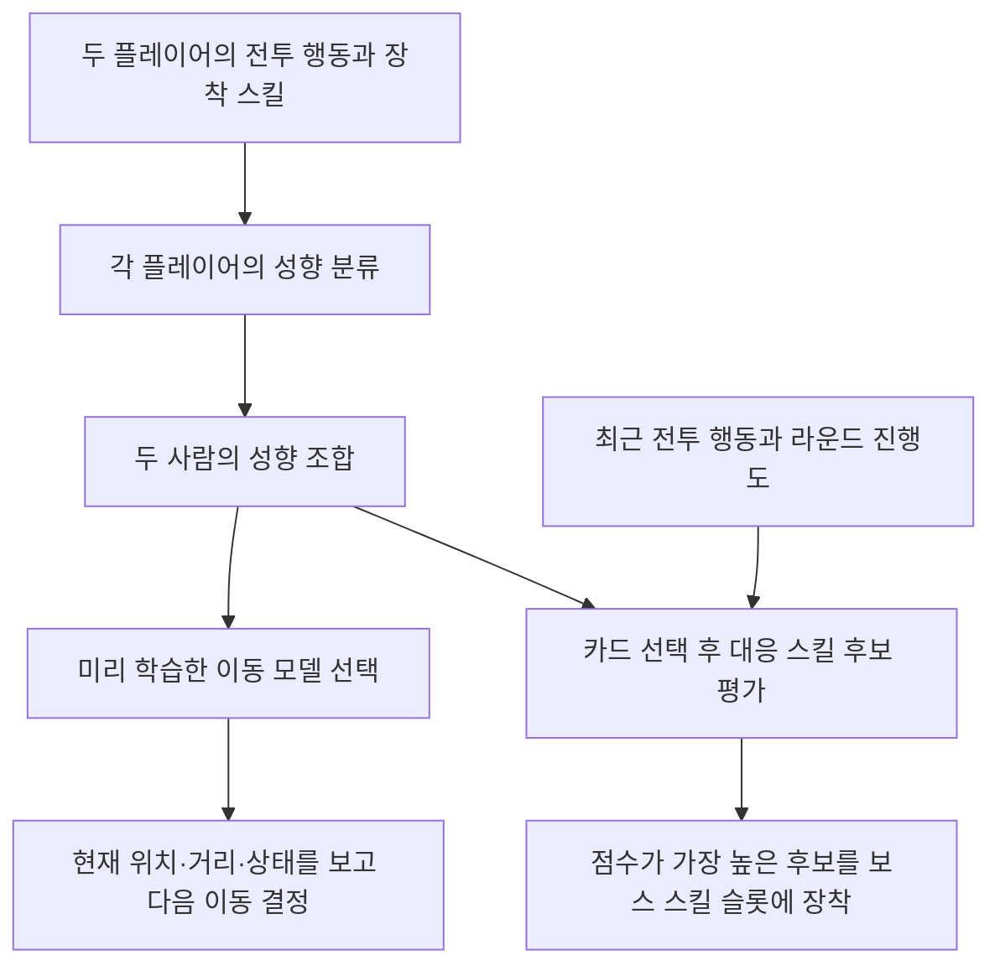

# 테네브리스(Tenebris) | 2인 협동 보스전

두 플레이어가 한 팀이 되어 보스를 상대하는 Unity 기반 3D 탑다운 액션 게임입니다. 보스는 두 사람이 얼마나 가까이에서 싸우고 어떤 스킬을 쓰는지 관찰합니다. 두 사람의 전투 성향에 따라 보스의 이동 방식과 다음에 사용할 수 있는 스킬 구성이 달라집니다.

## 한 판의 흐름

1. **방 만들기와 참가** — 한 명이 방을 열고 다른 한 명이 참가합니다. 방을 연 플레이어가 호스트를 맡습니다.
2. **협동 전투** — 두 플레이어가 보스를 공격하는 동안 호스트가 공격과 스킬 효과를 판정하고, 그 결과를 두 화면에 동기화합니다.
3. **카드 선택** — 플레이어가 카드를 골라 스킬을 구성합니다. 카드 선택이 끝나면 보스도 두 플레이어의 성향과 최근 전투 행동을 반영해 대응 스킬을 고릅니다.

| 방 생성·참가 | 카드 선택 |
| --- | --- |
|  |  |
| 호스트가 방을 만들고 다른 플레이어가 참가 코드를 입력하는 메뉴입니다. | 플레이어가 다음 전투에 사용할 스킬을 구성하는 선택 단계입니다. |

## 아키텍처

1. **Relay · Unity Transport** — 호스트와 참가자 간의 게임 통신을 연결합니다. Netcode for GameObjects는 전투 씬 전환과 네트워크 오브젝트의 상태를 동기화합니다.
2. **호스트 전투 처리** — 호스트가 입력과 스킬 요청을 확인하고 명중·피해·상태 변화를 확정합니다. 참가자는 NetworkVariable과 RPC로 전달받은 결과를 화면에 표시합니다.
3. **보스 AI** — 호스트가 두 플레이어의 성향 조합에 맞는 ONNX 모델을 선택해 이동을 결정하고, 카드 선택 이후에는 가중치 규칙으로 대응 스킬을 구성합니다.

[멀티플레이 실행 구조](docs/portfolio/multiplayer-runtime.md) · [전투 및 스킬 시스템](docs/portfolio/combat-skill-system.md) · [보스 AI 연동](docs/portfolio/boss-ai-integration.md)

## 보스는 어떻게 대응하나요?

보스는 근접 공격, 보스와의 거리, 사용하거나 장착한 스킬을 바탕으로 각 플레이어를 **근접형·원거리형·군중제어형·혼합형**으로 분류합니다. 두 사람의 성향 조합은 이동 모델을 고를 때와 대응 스킬을 고를 때 모두 사용합니다.

별도 학습 환경에서 보스 이동 모델을 학습해 ONNX로 내보냅니다. 게임 호스트는 미리 학습된 모델 중 두 플레이어의 성향 조합에 맞는 모델을 선택해 보스의 다음 이동을 추론합니다. 보스가 행동 중이면 모델 교체를 보류합니다. 스킬 선택은 가중치 규칙이, 피해 판정은 호스트의 전투 코드가 담당합니다. [BuildUp 학습 프로젝트](https://github.com/paek678/BuildUp)

## 개발 정보

| 항목 | 내용 |
| --- | --- |
| 개발 | 빌드업 팀 |
| 개발기간 | 2026.03.30 ~ 2026.06.07 |
| 게임 엔진 | Unity 6000.3.11f1 |
| 멀티플레이 | Netcode for GameObjects · Unity Transport · Lobby · Relay · Authentication |
| 보스 이동 AI | Unity ML-Agents · ONNX 모델 추론 |

## 코드와 문서

- [보스 AI 연동](docs/portfolio/boss-ai-integration.md) · [게임에 포함된 이동 모델](Assets/onnx_9matchup/) · [학습 프로젝트 BuildUp](https://github.com/paek678/BuildUp)
- [멀티플레이 실행 구조](docs/portfolio/multiplayer-runtime.md) · [전투와 스킬 시스템](docs/portfolio/combat-skill-system.md)
- [프로젝트 개요](docs/portfolio/overview.md) · [개발·검토 기록](docs/portfolio/ai-development-harness.md)

## 팀원

<table>
  <thead>
    <tr>
      <th>백성열</th>
      <th>홍채영</th>
    </tr>
  </thead>
  <tbody>
    <tr>
      <td align="center">
        
         <a href="https://github.com/paek678">@paek678</a>
      </td>
      <td align="center">
        
         <a href="https://github.com/hongchaeyoung0918-code">@hongchaeyoung0918-code</a>
      </td>
    </tr>
    <tr>
      <td align="center">기획 · 서버 구축 · 몬스터 AI 구현</td>
      <td align="center">클라이언트 개발 · 서버 연결 · 셰이더 추가</td>
    </tr>
  </tbody>
</table>

