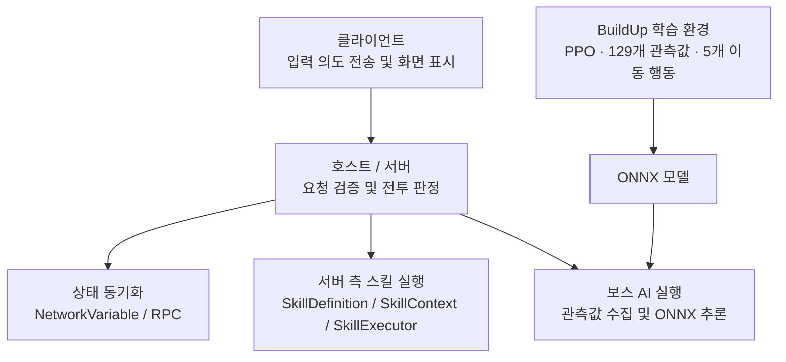

# ArenaCombat_server

> 호스트 권한 기반의 2인 협동 보스전 게임으로, 서버 측 전투·스킬 판정과 ONNX 기반 보스 이동 AI 연동 구조를 구현한 Unity 프로젝트입니다.

ArenaCombat_server는 두 명의 플레이어가 협력하여 보스를 상대하는 멀티플레이 게임의 실행 환경입니다. 클라이언트는 이동이나 공격 등의 입력 의도를 전송하고, 호스트는 요청을 검증한 뒤 전투 결과와 스킬 효과를 처리합니다. 확정된 상태는 Unity Netcode for GameObjects를 통해 동기화합니다.

보스 이동 정책은 별도의 [BuildUp 학습 프로젝트](#related-project-buildup-ml-training)에서 학습하고 ONNX 모델로 가져옵니다. 학습 모델은 이동 판단을 담당하며, 스킬 실행과 전투 규칙, 멀티플레이 권한은 게임 실행 환경에서 처리합니다.

## 주요 기능

- 호스트가 판정 권한을 갖는 2인 협동 보스전 멀티플레이 구조
- 입력 의도, 전투 요청, 스킬 사용을 검증하고 결과를 동기화하는 서버 로직
- 공통 스킬 정의와 실행 문맥을 사용하는 데이터 기반 자동 시전 시스템
- ONNX 모델을 활용한 보스 이동 추론 연동 구조

## 기술 스택

| 구분 | 버전 및 도구 |
| --- | --- |
| 게임 엔진 | Unity `6000.3.11f1` |
| 네트워킹 | Netcode for GameObjects `2.11.2` |
| 전송 계층 | Unity Transport `2.7.2` |
| 입력 | Unity Input System `1.19.0` |
| 렌더링 | URP `17.3.0` |
| 연결 서비스 | Relay `1.0.5`, Lobby `1.3.0`, Authentication `3.6.1` |
| 모델 실행 | Unity ML-Agents `4.0.2`, ONNX 모델 |

## 전체 구조

## 핵심 시스템

### 호스트 권한 기반 멀티플레이

클라이언트는 입력 의도를 전송하고, 호스트가 요청을 검증하여 이동, 전투, 스킬 효과를 판정한 뒤 상태를 동기화합니다.

관련 코드와 문서는 다음과 같습니다.

- `Assets/ArenaCombat/Scripts/Core/Network/` — C# 파일 17개
- `Assets/ArenaCombat/Docs/NETWORK_ARCHITECTURE.md`
- `Assets/ArenaCombat/Docs/PROJECT_STRUCTURE.md`

### 전투 및 스킬 실행

전투 판정과 스킬 효과는 호스트 권한으로 처리합니다. 스킬 데이터와 실행 로직을 분리하여 여러 종류의 스킬이 공통 실행 구조를 사용하도록 구성했습니다.

관련 코드와 문서는 다음과 같습니다.

- `Assets/ArenaCombat/Scripts/Core/Combat/` — C# 파일 5개
- `Assets/ArenaCombat/Scripts/Core/Skill/` — C# 파일 19개
- `Assets/ArenaCombat/Docs/SKILL_SYSTEM_DESIGN.md`

### 보스 AI 연동

보스 AI는 학습 모델과 규칙 기반 로직을 결합한 구조입니다. ONNX 모델이 보스 이동 정책을 제공하고, 스킬 실행과 전투 규칙, 네트워크 권한은 서버 측 시스템에서 처리합니다.

관련 코드와 자산은 다음과 같습니다.

- `Assets/ArenaCombat/Scripts/Core/AI/` — C# 파일 12개
- `Assets/ML-Agents/`
- `Assets/onnx_9matchup/`
- `Assets/ArenaCombat/Docs/BUILDUP_INTEGRATION_PLAN.md`
- `Assets/ArenaCombat/Docs/ML_TRAINING_REFERENCE.md`

## 연관 프로젝트 BuildUp

BuildUp은 이 게임에 사용할 보스 이동 정책을 학습하는 별도의 Unity ML-Agents 프로젝트입니다.

주요 담당 영역은 다음과 같습니다.

- PPO 기반 이동 정책 학습
- 129개 관측값 구성
- 5개 이산 이동 행동 설계
- 플레이어 성향 조합별 학습 결과 분석
- ONNX 모델 출력 및 ArenaCombat_server와의 연동 규격 정리

저장소: [BuildUp](https://github.com/paek678/BuildUp)

## 관련 문서

- [프로젝트 개요](docs/portfolio/overview.md)
- [멀티플레이 실행 구조](docs/portfolio/multiplayer-runtime.md)
- [전투 및 스킬 시스템](docs/portfolio/combat-skill-system.md)
- [보스 AI 연동](docs/portfolio/boss-ai-integration.md)
- [AI 도구를 활용한 개발 및 검토 기록](docs/portfolio/ai-development-harness.md)

## 현재 구현 및 검증 범위

현재 저장소는 멀티플레이 실행 환경과 보스 AI 연동 구조를 개발한 프로젝트입니다. 최종 상용 게임의 완성도나 성능 검증을 완료한 상태를 의미하지는 않습니다.

프로젝트 파일에서 확인할 수 있는 내용은 다음과 같습니다.

- Unity 프로젝트 및 패키지 버전 설정
- 네트워크, 스킬, 전투, AI 실행 관련 코드
- 게임 실행 프로젝트에 배치된 ONNX 모델 자산
- 개발 변경 사항과 검토 결과 기록

추가로 확인할 항목은 다음과 같습니다.

- 최종 플레이 가능한 데모와 시연 영상
- 네트워크 지연 및 멀티플레이 부하 테스트
- 가져온 ONNX 모델별 실제 게임 내 동작
- 최종 스킬 구성과 전투 밸런스
