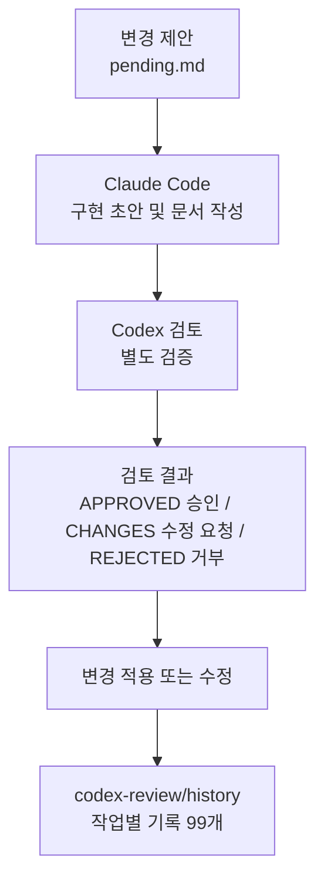

# AI 도구를 활용한 개발 및 검토 기록

## 목적

이 프로젝트는 AI 도구의 역할을 분리하여 구현과 검토를 진행하는 개발 절차를 사용했습니다.

이 문서는 구현 초안과 별도 검토를 구분한 개발 과정의 기록입니다. AI 도구를 사용했다는 사실만으로 개발자의 설계 판단이나 수동 검증이 대체되었다고 볼 수는 없습니다.

## 작업 흐름

## 관련 파일과 기록

- `codex-review/pending.md`
- `codex-review/CODEX_PROTOCOL.md`
- `codex-review/README.md`
- `codex-review/codex-session-prompt.md`
- `codex-review/history/` — Markdown 검토 기록 99개
- `.mcp.json`
- `.claude/settings.local.json`

## 개발 과정 설명

구현 초안 작성과 검토를 서로 다른 단계로 구분했습니다. Claude는 구현과 문서 작성을 담당하고, Codex는 제안된 변경 사항을 검토하는 단계에 사용했습니다. 이를 통해 판정 권한, 상태 동기화, 확인되지 않은 가정과 관련된 문제를 변경 적용 전에 점검할 수 있도록 했습니다.

## 활용 목적

멀티플레이 게임 코드는 판정 권한의 경계와 상태 동기화, 작은 구현 가정에도 영향을 받습니다. 변경 제안과 검토 결과를 기록하면 어떤 판단을 거쳐 구현했는지 추적할 수 있습니다.
