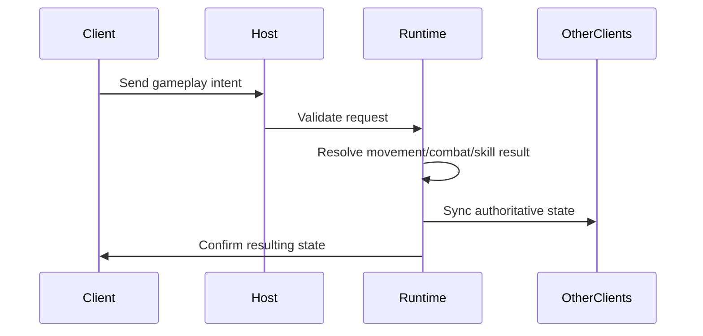

# Multiplayer Runtime

## Goal

The multiplayer runtime is designed around host-authoritative gameplay.

Clients should not directly decide final gameplay state. Instead, they send intent and the host resolves the result.

## Core Flow

## Authority and Synchronization

One participant runs the host, combining server and client roles. Remote clients send gameplay intent; the host validates requests and determines the resulting gameplay state.

Persistent state is synchronized through `NetworkVariable` values, while RPCs carry requests and gameplay events. Client presentation follows the authoritative results.

## Verified Project Evidence

- Unity Netcode for GameObjects `2.11.2`
- Unity Transport `2.7.2`
- [Network runtime code](../../Assets/ArenaCombat/Scripts/Core/Network/)
- [Network architecture notes](../../Assets/ArenaCombat/Docs/NETWORK_ARCHITECTURE.md)

## Validation

Authority checks and synchronization paths are implemented in the runtime code. Latency, disconnect handling, and multiplayer stress behavior require playtesting; the architecture alone does not establish measured network performance or complete cheat prevention.
