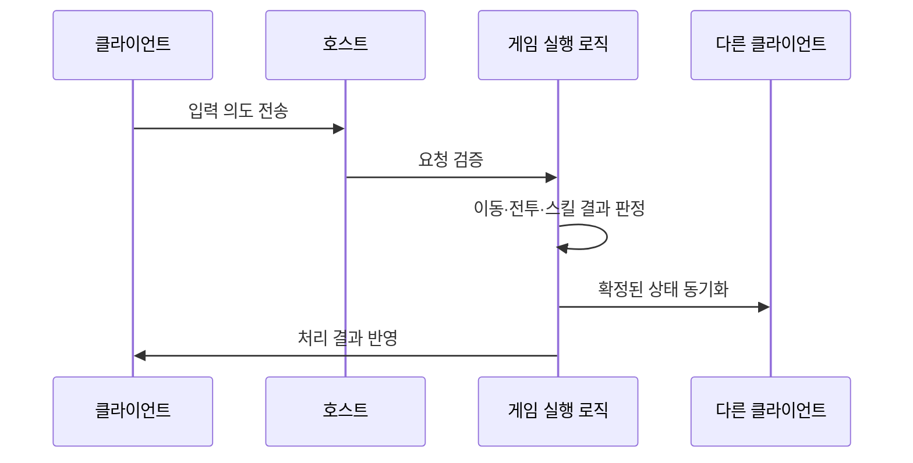

# 멀티플레이 실행 구조

## 설계 목적

멀티플레이 실행 환경은 호스트가 최종 판정 권한을 갖는 구조로 설계했습니다.

클라이언트는 게임 상태를 직접 확정하는 대신 입력 의도를 전송하고, 호스트가 요청에 따른 결과를 판정합니다.

## 처리 흐름

## 판정 권한과 동기화

참가자 중 한 명이 호스트를 실행하며 서버와 클라이언트 역할을 함께 수행합니다. 원격 클라이언트는 입력 의도를 전달하고, 호스트는 요청을 검증하여 게임 상태를 결정합니다.

계속 유지하고 동기화해야 하는 상태는 `NetworkVariable`로 공유하며, 요청과 게임 내 사건은 RPC로 전달합니다. 클라이언트 화면과 연출은 호스트가 확정한 결과를 바탕으로 처리합니다.

## 관련 코드 및 문서

- Unity Netcode for GameObjects `2.11.2`
- Unity Transport `2.7.2`
- [네트워크 실행 코드](../../Assets/ArenaCombat/Scripts/Core/Network/)
- [네트워크 구조 기록](../../Assets/ArenaCombat/Docs/NETWORK_ARCHITECTURE.md)

## 검증 범위

판정 권한 검사와 동기화 경로는 실행 코드에 구현되어 있습니다. 네트워크 지연, 연결 종료 처리, 멀티플레이 부하 상황의 동작은 플레이 테스트로 확인해야 합니다. 구조 설계만으로 측정된 네트워크 성능이나 모든 부정행위에 대한 방어가 보장되지는 않습니다.
